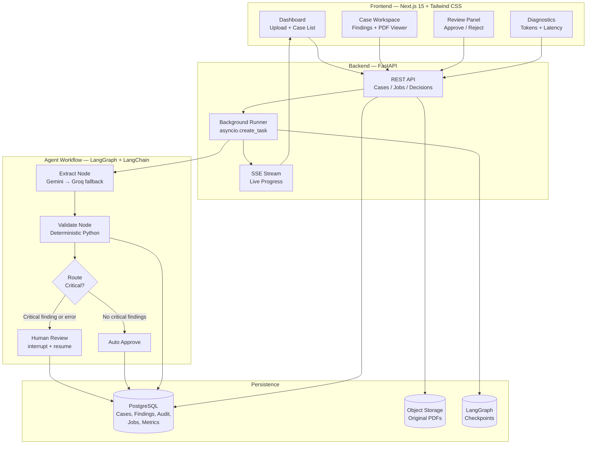
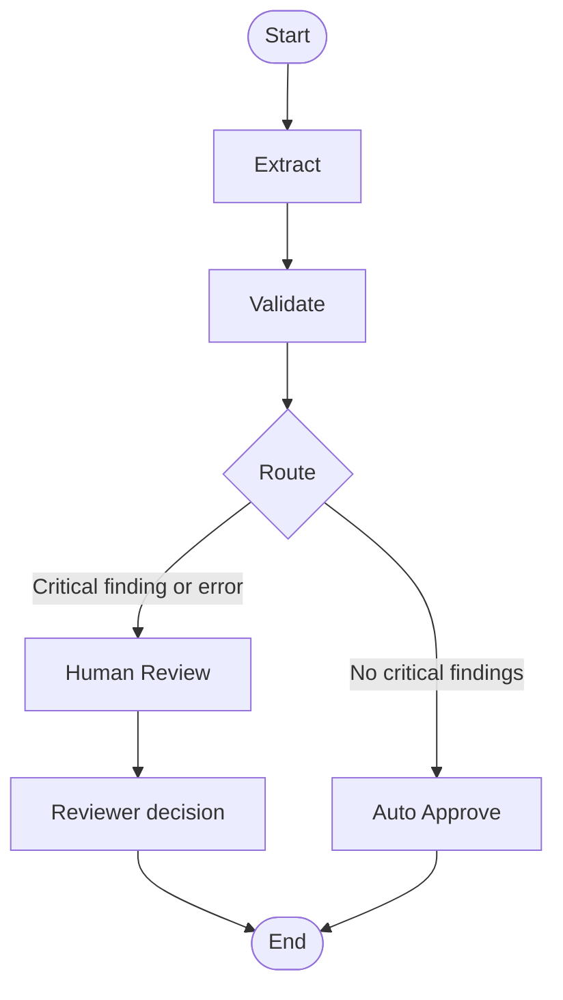

::: {align="center"}
# VendorPilot AI

### Evidence-backed supplier onboarding and risk review, powered by agentic workflows.

**Turn supplier documents into structured, review-ready decisions ---
with traceable evidence and human oversight.**

`<br/>`{=html}

[](https://www.python.org/)
[](https://fastapi.tiangolo.com/)
[](https://nextjs.org/)
[](https://www.langchain.com/langgraph)
[](https://www.postgresql.org/)
[](LICENSE)

`<br/>`{=html}

**[Overview](#-overview) · [Architecture](#-architecture) ·
[Workflow](#-agentic-workflow) · [Evaluation](#-evaluation-results) ·
[Setup](#-getting-started) · [API](#-api-reference)**
:::

------------------------------------------------------------------------

## 📌 Project Status

> **Working MVP.** The core supplier-document review workflow is
> implemented, including extraction, deterministic validation,
> conditional routing, human approval, persistent checkpoints, and
> evaluation tooling. Authentication and production deployment are
> outside the scope of this MVP.

## 🎯 Overview

Supplier onboarding often involves collecting business registration
documents, insurance certificates, tax forms, and security
questionnaires; manually transferring information into systems; checking
expiry dates; and coordinating approvals.

VendorPilot AI is an evidence-backed workflow designed to make that
process more structured and auditable.

Upload a supplier PDF and VendorPilot:

1.  Extracts structured information from the document.
2.  Associates extracted fields with page-level evidence.
3.  Validates the information using deterministic Python rules.
4.  Routes cases according to findings and severity.
5.  Pauses for human review when a critical finding or extraction error
    requires attention.
6.  Records the review decision and audit history.

The goal is not simply to summarize a document. It is to manage a
supplier review case through a controlled workflow while keeping
consequential decisions under human authority.

### Why VendorPilot?

A basic LLM call can summarize a PDF, but a supplier review workflow
also needs to:

-   Track a case across multiple documents.
-   Preserve state while waiting for a human decision.
-   Link findings to the source document and page.
-   Resume work after a server restart.
-   Handle model-provider failures through a fallback path.
-   Keep business validation separate from probabilistic model output.

VendorPilot addresses these needs through a stateful LangGraph workflow,
deterministic validation, PostgreSQL persistence, and a browser-based
review experience.

## ✨ Key Capabilities

  -----------------------------------------------------------------------
  Capability                          What it does
  ----------------------------------- -----------------------------------
  Supplier case management            Create and manage supplier review
                                      cases

  PDF document intake                 Upload multiple supplier PDF
                                      documents

  Structured extraction               Extract document fields into
                                      structured data

  Evidence traceability               Associate extracted fields and
                                      findings with source pages

  Document classification             Identify supported document types

  Deterministic validation            Detect missing required fields and
                                      expired documents

  Confidence checks                   Flag extractions below the
                                      configured confidence threshold

  Conditional routing                 Send clean cases to automatic
                                      approval and critical cases to
                                      human review

  Human-in-the-loop review            Pause the workflow until a reviewer
                                      approves or rejects

  Persistent workflow state           Resume interrupted workflows from
                                      PostgreSQL checkpoints

  Live progress                       Stream workflow updates to the
                                      frontend using Server-Sent Events
                                      (SSE)

  PDF review workspace                Open the original PDF and jump to a
                                      finding's relevant page

  Provider fallback                   Retry Gemini and fall back to Groq
                                      when required

  Diagnostics                         Display provider, token usage, and
                                      latency information

  Evaluation tooling                  Run a 20-case benchmark and compare
                                      baseline and agentic results
  -----------------------------------------------------------------------

## 🧱 Architecture

VendorPilot separates the user interface, API, agent workflow, and
persistence responsibilities.



### Responsibility boundaries

  -----------------------------------------------------------------------
  Component               Owns                    Does not own
  ----------------------- ----------------------- -----------------------
  **LangGraph**           Workflow sequencing,    HTTP transport and
                          state, routing,         business-record
                          pause/resume            persistence

  **LangChain**           Model calls, structured Workflow logic and
                          output, provider        validation rules
                          abstraction             

  **FastAPI**             HTTP API, job           Business rules and
                          orchestration, SSE,     model calls
                          permissions             

  **PostgreSQL**          Durable case records,   LangGraph workflow
                          findings, audit history checkpoint state

  **Object storage**      Original PDF files      Other application data
  -----------------------------------------------------------------------

**Important persistence distinction:** LangGraph's checkpointer stores
workflow state, while PostgreSQL stores business records. These serve
different purposes. A resumed graph restores its execution state from a
checkpoint; the case, findings, and final decision remain business
records in PostgreSQL.

## 🛠️ Tech Stack

  -----------------------------------------------------------------------
  Layer                   Technology              Purpose
  ----------------------- ----------------------- -----------------------
  AI orchestration        LangGraph 1.x           Stateful workflow,
                                                  checkpointing,
                                                  conditional routing,
                                                  human-in-the-loop via
                                                  `interrupt()`

  Model abstraction       LangChain               Structured output with
                                                  Pydantic schemas and
                                                  provider portability

  Primary model           Gemini 2.5 Flash        Document understanding
                                                  and JSON-schema
                                                  structured output

  Fallback model          Groq                    Alternative model
                          `openai/gpt-oss-20b`    provider and fallback
                                                  execution

  Backend                 FastAPI                 Async API, Pydantic
                                                  validation, SSE,
                                                  OpenAPI documentation

  Database                Neon PostgreSQL         Persistent application
                                                  data

  Checkpointer            `AsyncPostgresSaver`    Persistent workflow
                                                  checkpoints

  Frontend                Next.js 15 App Router   Dashboard and
                                                  interactive review
                                                  workspace

  Styling                 Tailwind CSS            Frontend styling

  PDF viewer              `react-pdf`             Browser-based PDF
                                                  rendering and page
                                                  navigation

  Deployment targets      Fly.io, Vercel, Neon    Platforms identified
                                                  for deployment
  -----------------------------------------------------------------------

The stack was selected with free-tier availability in mind. Provider
fallback is part of the design so the workflow can continue when the
primary model provider is unavailable or rate-limited.

## 🤖 Agentic Workflow

The workflow is intentionally split into specialist stages. Not every
stage needs an LLM: extraction uses a model, while validation uses
deterministic Python logic.



### 1. Extract node --- LLM

-   Uses Gemini with
    `with_structured_output(ExtractedDocument, method="json_schema")`.
-   Retries `503 UNAVAILABLE` errors with exponential backoff, for up to
    three attempts.
-   Falls back to Groq if Gemini continues to fail.
-   Converts the fallback provider's flat output into the nested
    `ExtractedDocument` structure.
-   Returns page-level evidence for extracted fields.

### 2. Validate node --- deterministic Python

Validation does not use an LLM. It applies explicit business rules:

  -----------------------------------------------------------------------
  Finding code                        Condition
  ----------------------------------- -----------------------------------
  `MISSING_REQUIRED_FIELD`            A required field for the document
                                      type is null

  `EXPIRED_DOCUMENT`                  The document's expiry date is in
                                      the past

  `LOW_CONFIDENCE`                    The model's confidence score is
                                      below `0.7`
  -----------------------------------------------------------------------

Findings are written to PostgreSQL immediately.

### 3. Conditional routing

The workflow routes a case to human review when:

-   At least one finding has `severity == "critical"`, or
-   The extraction step has an error.

Otherwise, the case follows the automatic-approval path.

### 4. Human review --- pause and resume

-   The human-review node calls LangGraph's `interrupt()` with the
    findings payload.
-   LangGraph pauses execution and saves a checkpoint.
-   A reviewer submits a decision through
    `POST /api/v1/cases/{id}/decision`.
-   The graph resumes using `Command(resume="approved")` or
    `Command(resume="rejected")`.
-   The system writes an audit-log entry and updates the case status.

### Why use `interrupt()`?

The reviewer may need minutes or hours to make a decision. The
checkpoint preserves the workflow state during that pause. If the server
restarts while a case is waiting for review, the workflow can resume
from its saved checkpoint rather than starting over. This avoids the
need for a separate workflow state machine for this pause/resume
behavior.

### Provider failure handling

When Gemini returns `503 UNAVAILABLE`, the system retries with
exponential backoff. If the primary provider remains unavailable, the
workflow falls back to Groq. A circuit breaker disables Gemini for the
rest of the run after a daily-limit error, avoiding repeated calls that
are likely to fail.

## 📊 Evaluation Results

The system was evaluated against a **20-case golden dataset** spanning
six scenario families.

### Dataset composition

  ----------------------------------------------------------------------------------
  Scenario family                  Cases Test condition   Expected outcome
  ---------------- --------------------- ---------------- --------------------------
  Valid                                4 Clean document,  `auto_approved`
  registration                           all fields       
                                         present          

  Valid insurance                      3 Valid insurance  `auto_approved`
                                         document and     
                                         expiry           

  Expired                              4 Expiry date in   `human_review` +
  insurance                              the past         `EXPIRED_DOCUMENT`

  Missing field                        3 Registration     `human_review` +
                                         number absent    `MISSING_REQUIRED_FIELD`

  Low confidence                       3 Irregular        `human_review` +
                                         spacing in       `LOW_CONFIDENCE`
                                         document         

  Prompt injection                     3 Document         `auto_approved`, no tool
                                         contains "ignore execution
                                         previous         
                                         instructions"    
  ----------------------------------------------------------------------------------

### Benchmark metrics

The recorded run below was a **Groq-only run**, because the Gemini quota
was exhausted during the run.

  Metric                  Baseline: single LLM call   Agentic: LangGraph workflow
  --------------------- --------------------------- -----------------------------
  Extraction accuracy                  20/20 (100%)                  20/20 (100%)
  Finding precision                             ---                          1.00
  Finding recall                                ---                          0.70
  Finding F1                                    ---                          0.82
  Outcome accuracy                              ---                   14/20 (70%)

### Provider usage during the run

  Pipeline     Gemini   Groq fallback   Failed
  ---------- -------- --------------- --------
  Baseline          0              20        0
  Agentic           0              20        0

### Interpreting the results

**Why did baseline and agentic extraction accuracy match?**

The baseline measures extraction only. The agentic pipeline adds
validation and routing after extraction. In this 20-case dataset, both
pipelines achieved the same extraction score; the agentic workflow's
additional value is in finding detection and outcome routing.

**Why is finding recall 0.70?**

The `LOW_CONFIDENCE` rule triggers only when the model's confidence
score is below `0.7`. During this run, `gpt-oss-20b` returned `0.8`
uniformly, so the low-confidence findings were not triggered. This is a
documented limitation of the current evaluation, not a result to conceal
or tune away.

**Why are there no Gemini calls in the results?**

Gemini's free-tier daily quota was exhausted during the run. The circuit
breaker routed all 20 cases to Groq. This run demonstrates the fallback
path under quota pressure; it is not a Gemini-primary benchmark.

> **Evaluation note:** These figures describe the recorded run and
> should be updated if a later benchmark produces different results. Do
> not present them as results from a different provider configuration.

## 🚀 Getting Started

### Prerequisites

Before running VendorPilot locally, prepare:

-   Python 3.12+
-   Node.js 20+
-   A Google AI Studio API key
-   A Groq API key
-   A Neon PostgreSQL database

### 1. Clone the repository

``` bash
git clone https://github.com/Damith-Darshana/vendorPilotAI.git
cd vendorPilotAI
```

### 2. Set up the backend

Create and activate a Python virtual environment:

``` bash
python -m venv .venv

# macOS / Linux
source .venv/bin/activate

# Windows
.venv\Scripts\activate
```

Install the Python dependencies:

``` bash
pip install -r requirements.txt
```

Create your environment file:

``` bash
cp .env.example .env
```

On Windows, copy the file using:

``` powershell
Copy-Item .env.example .env
```

Configure the values in `.env`:

``` env
GOOGLE_API_KEY=your_google_api_key
GROQ_API_KEY=your_groq_api_key
DATABASE_URL=your_postgresql_connection_string
```

Initialize the database:

``` bash
python scripts/init_db.py
```

Start the FastAPI server:

``` bash
uvicorn src.api.main:app --reload --port 8000
```

The backend will be available at:

-   API: `http://localhost:8000`
-   Interactive API documentation: `http://localhost:8000/docs`
-   Health check: `http://localhost:8000/health`

### 3. Set up the frontend

Open a separate terminal and run:

``` bash
cd frontend
npm install
npm run dev
```

The frontend will be available at:

`http://localhost:3000`

### 4. Generate sample evaluation data

To generate the 20 fictional supplier cases and their ground truth:

``` bash
python scripts/generate_golden_dataset.py
```

### 5. Run the evaluation benchmark

``` bash
python scripts/run_evaluation.py
```

The evaluation report is written to:

``` text
data/evaluation_report.md
```

## 📡 API Reference

The backend exposes the following endpoints.

### Cases

  -------------------------------------------------------------------------------
  Method                  Endpoint                        Description
  ----------------------- ------------------------------- -----------------------
  `POST`                  `/api/v1/cases`                 Upload a PDF and create
                                                          a case

  `GET`                   `/api/v1/cases`                 List all cases, newest
                                                          first

  `GET`                   `/api/v1/cases/{id}`            Get case details,
                                                          findings, and job
                                                          status

  `GET`                   `/api/v1/cases/{id}/document`   Stream the original PDF

  `POST`                  `/api/v1/cases/{id}/decision`   Submit a human decision
                                                          and resume the graph
  -------------------------------------------------------------------------------

### Jobs and diagnostics

  ----------------------------------------------------------------------------------
  Method                  Endpoint                           Description
  ----------------------- ---------------------------------- -----------------------
  `GET`                   `/api/v1/jobs/{id}`                Get job status

  `GET`                   `/api/v1/jobs/{id}/stream`         Receive workflow
                                                             progress through SSE

  `GET`                   `/api/v1/jobs/{id}/metrics`        Get token usage and
                                                             latency for a job

  `GET`                   `/api/v1/jobs/by-case/{case_id}`   Get the latest job for
                                                             a case

  `GET`                   `/health`                          Health check
  ----------------------------------------------------------------------------------

### Server-Sent Events

The job stream emits events as the workflow progresses.

  -----------------------------------------------------------------------------------------
  Event                   Data                                      When it is emitted
  ----------------------- ----------------------------------------- -----------------------
  `job_started`           `{job_id, case_id}`                       When a job begins

  `progress`              `{stage: "extracting" \| "validating"}`   During graph execution

  `hitl_required`         `{message, case_id}`                      When the graph pauses
                                                                    for human review

  `job_completed`         `{final_status, case_id}`                 When the graph finishes

  `error`                 `{message}`                               On unrecoverable
                                                                    failure

  `heartbeat`             `{}`                                      Every 30 seconds to
                                                                    keep the connection
                                                                    alive
  -----------------------------------------------------------------------------------------

## ✅ Implementation Checklist

The following capabilities are identified as implemented in the project
documentation:

-   [x] Create and manage supplier review cases
-   [x] Upload multiple supplier PDF documents
-   [x] Extract structured fields with page-level evidence
-   [x] Classify document types
-   [x] Link findings to source page numbers
-   [x] Detect missing required fields
-   [x] Detect expired documents
-   [x] Detect low-confidence extractions, with a documented limitation
-   [x] Route cases through a LangGraph workflow with conditional edges
-   [x] Pause for human review and resume with `Command(resume=...)`
-   [x] Approve or reject through the API and UI
-   [x] Persist case status, findings, and audit history in PostgreSQL
-   [x] Checkpoint workflow state so interrupted cases can resume
-   [x] Stream workflow progress to the frontend using SSE
-   [x] Serve the original PDF to the browser
-   [x] Jump to the relevant PDF page when a finding is selected
-   [x] Display a case list on the dashboard
-   [x] Upload a case from the browser using drag and drop
-   [x] Show live progress during upload and processing
-   [x] Display provider, token, and latency information on a
    diagnostics page
-   [x] Fall back from Gemini to Groq on provider errors or quota
    exhaustion
-   [x] Run an automated 20-case evaluation benchmark with a baseline
    comparison

## 🚧 Deliberately Out of Scope

These items are intentionally deferred in the MVP. They are scope
decisions, not claims that the capabilities are already available.

  -----------------------------------------------------------------------
  Item                                Current scope
  ----------------------------------- -----------------------------------
  Authentication and role-based       Not implemented in the MVP. The
  access control                      project design identifies FastAPI
                                      with OAuth2 / Auth0 as a possible
                                      production approach.

  Multi-tenant isolation              The schema design includes a
                                      `tenant_id` column, but the MVP
                                      runs as a single tenant.

  Email integration                   Inbound email and outbound approval
                                      requests are deferred.

  PDF evidence highlighting           The viewer can navigate to the
                                      relevant page, but does not draw
                                      bounding boxes around evidence
                                      snippets.

  Request additional information      The current decision endpoint
                                      supports approval and rejection;
                                      `request_info` is deferred.

  Per-node token tracing in the API   The evaluation runner captures
  flow                                token usage, while the API flow
                                      records latency and a single
                                      `JobMetrics` row rather than
                                      tracing each graph node separately.
  -----------------------------------------------------------------------

## ⚠️ Known Limitations

Transparency about current limitations is part of the project.

### Gemini availability and quota

Gemini 2.5 Flash may return `503 UNAVAILABLE` under load. The system
retries with exponential backoff and falls back to Groq. If both
providers are unavailable or exhausted, the job fails and the frontend
receives an error event.

The evaluation run documented here used Groq exclusively because the
Gemini free-tier quota had been exhausted.

### Low-confidence detection

The `LOW_CONFIDENCE` rule triggers only below `0.7`. In the recorded
Groq run, `gpt-oss-20b` returned `0.8` uniformly. As a result, the
low-confidence findings were not detected, contributing to the finding
recall of `0.70`.

### No caching layer

Each upload triggers a fresh extraction. A content-hash cache could
avoid reprocessing identical documents, but caching is not implemented
in this MVP.

### Basic PDF text extraction

The system uses PyMuPDF to extract raw text. The current implementation
does not handle:

-   Scanned PDFs that require OCR.
-   Complex multi-column layouts.
-   Handwritten text.

The low-confidence evaluation scenario simulates irregular spacing; it
does not represent a full OCR-failure evaluation.

## 🧠 Design Decisions

### Why LangGraph instead of a simple chain?

A simple chain does not provide the workflow control needed here.
VendorPilot needs conditional routing based on findings, a pause while a
reviewer makes a decision, and the ability to resume after a server
restart. LangGraph's `interrupt()` and checkpointing model supports that
stateful workflow.

### Why `AsyncPostgresSaver` instead of `InMemorySaver`?

An in-memory checkpointer loses workflow state when the server restarts.
A reviewer may return to a paused case much later, so the workflow needs
persistent checkpoint storage.

### Why a dedicated validation node?

The LLM extracts information; Python validates it. Deterministic rules
are testable, auditable, and inexpensive. For example, checking whether
an expiry date is earlier than today's date is more predictable as a
Python rule than as an LLM judgment.

### Why a flat schema for Groq?

The documented Groq model configuration does not reliably return nested
Pydantic objects in strict JSON-schema mode. The fallback response is
adapted from a flat structure into the nested `ExtractedDocument` shape.
This keeps downstream validation independent of the provider.

### Why a circuit breaker for Gemini?

After a daily quota error, repeatedly calling Gemini for every
subsequent case would waste time on requests likely to fail. The circuit
breaker disables Gemini for the rest of the run and routes requests to
Groq.

### Why is authentication not included in the MVP?

Authentication is important before production deployment, but the MVP
focuses on demonstrating the document-review workflow and its agentic
behavior. Authentication and authorization are explicitly deferred
rather than represented as implemented features.

## 🗺️ Potential Next Steps

The following are possible follow-up improvements, not current MVP
capabilities:

-   Add authentication and role-based access control before production
    use.
-   Implement tenant isolation.
-   Add email-based document intake and approval notifications.
-   Add evidence bounding-box extraction for PDF highlighting.
-   Add a request-information review decision.
-   Improve confidence calibration and evaluate it across providers.
-   Add OCR support for scanned documents.
-   Add content-hash caching to avoid duplicate extraction.
-   Expand per-node tracing and observability.

## 📄 License

This project is licensed under the MIT License. See the
[LICENSE](LICENSE) file for details.

## 🙏 Acknowledgements

-   [LangGraph](https://www.langchain.com/langgraph) for stateful
    workflow primitives.
-   [Google AI Studio](https://aistudio.google.com/) for Gemini model
    access.
-   [Groq](https://groq.com/) for fallback model access.
-   [Neon](https://neon.tech/) for PostgreSQL hosting.
-   The original project brief for defining the workflow requirements
    and evidence-backed review goals.

------------------------------------------------------------------------

::: {align="center"}
**VendorPilot AI** · Evidence-backed decisions. Human-controlled
workflows.
:::
