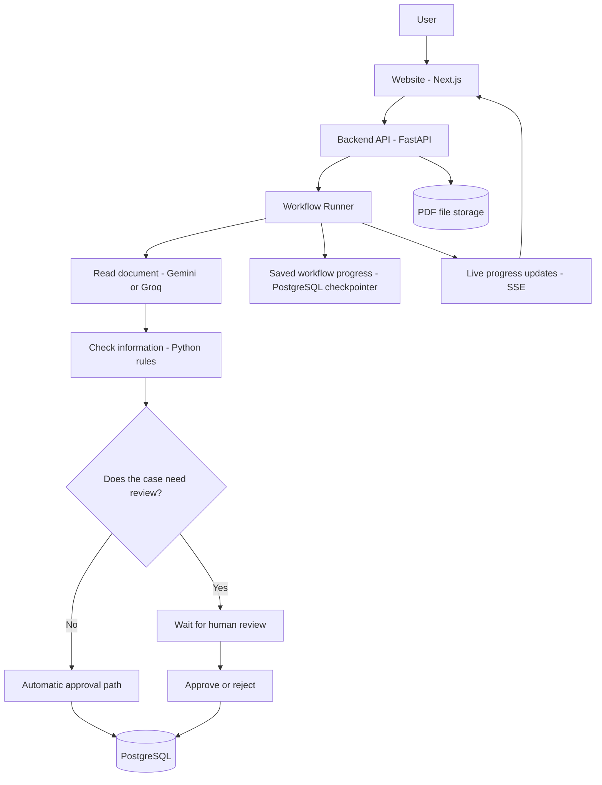

# VendorPilot AI

**An AI-powered supplier document review system that helps businesses check supplier documents, find problems, and make safer approval decisions.**

VendorPilot AI takes supplier documents (such as business registration documents and insurance certificates), reads the information, checks it against simple business rules, and helps a reviewer decide what to do next.

The important idea is that **AI does the reading, Python checks the rules, and a human makes important decisions when needed.**


---

## Table of Contents

- [What is VendorPilot AI?](#what-is-vendorpilot-ai)
- [Why did I build it?](#why-did-i-build-it)
- [How does it work?](#how-does-it-work)
- [Main features](#main-features)
- [Technology used](#technology-used)
- [How the system is organized](#how-the-system-is-organized)
- [How the AI workflow works](#how-the-ai-workflow-works)
- [Evaluation results](#evaluation-results)
- [Run the project on your computer](#run-the-project-on-your-computer)
- [API endpoints](#api-endpoints)
- [What is included in this version?](#what-is-included-in-this-version)
- [What is not included yet?](#what-is-not-included-yet)
- [Known limitations](#known-limitations)
- [Important technical decisions](#important-technical-decisions)
- [Possible future improvements](#possible-future-improvements)
- [License](#license)
- [Acknowledgements](#acknowledgements)

---

## What is VendorPilot AI?

Supplier onboarding is the process of checking a company before doing business with it.

A business may need to collect and check documents such as:

- Business registration certificates
- Insurance certificates
- Tax documents
- Security questionnaires

Doing all these checks manually can take time. Someone has to open each document, find the important information, check dates, identify missing details, and ask the right person to approve the supplier.

VendorPilot AI helps with this process.

You upload a supplier PDF. The system reads it, collects important information, checks for possible problems, and shows the results in a review screen.

For example, it can help identify:

- A missing business registration number
- An expired insurance certificate
- Information that the AI is not confident about

It also shows which page of the original PDF contains the information. This helps the reviewer check the result instead of simply trusting the AI.

## Why did I build it?

A normal AI chatbot can read a PDF and give you a summary. But a real supplier review process needs more than a summary.

For example:

- What happens if a document is missing important information?
- What happens if an insurance certificate has expired?
- How can a reviewer check where the AI got its information?
- What happens if the system stops while waiting for approval?
- What happens if the AI provider is temporarily unavailable?

VendorPilot was built to explore these problems.

The system does not allow the AI to make every decision by itself. It uses clear Python rules to check information and sends cases to a human when further review is needed.

## How does it work?

Here is the process in simple terms:

1. **Upload a document:** The user uploads a supplier PDF.
2. **Read the document:** The AI reads the PDF and extracts important information.
3. **Check the information:** Python checks whether required details are missing or documents have expired.
4. **Decide what happens next:** The system checks the results and chooses the next step.
5. **Ask for human review when needed:** If there is a serious problem or an extraction error, the workflow pauses.
6. **Record the decision:** The reviewer approves or rejects the case. The system saves the decision and its history.

A clean case can follow the automatic approval path. A case with a critical finding or extraction error is sent for human review.

## Main features

| Feature | Simple explanation |
|---|---|
| Supplier case management | Create and manage supplier review cases. |
| PDF upload | Upload supplier documents in PDF format. |
| Information extraction | Read important details from uploaded documents. |
| Document classification | Identify the type of document. |
| Page references | Show which PDF page contains the extracted information or finding. |
| Missing information checks | Find required details that are not present. |
| Expiry date checks | Identify documents that have expired. |
| Confidence checks | Flag information when the model's confidence score is below the configured limit. |
| Automatic routing | Send clean cases to the automatic approval path. |
| Human review | Pause cases that need a person to check them. |
| Approve or reject | Allow a reviewer to submit a decision. |
| Saved workflow progress | Continue a paused workflow after a server restart. |
| Live progress updates | Show the user what the system is doing. |
| PDF review screen | Open the original document and move to a relevant page. |
| AI provider fallback | Try Groq if Gemini cannot complete a request. |
| Diagnostics | Show information such as the AI provider, token usage, and processing time. |
| Evaluation | Test the system using a set of sample supplier cases. |

## Technology used

Here is a list of the main technologies and what each one does in this project.

| Technology | What it does in VendorPilot |
|---|---|
| **Python 3.12+** | Main programming language for the backend and validation rules. |
| **FastAPI** | Receives requests from the frontend and provides the backend API. |
| **Next.js 15** | Builds the website that users interact with. |
| **Tailwind CSS** | Controls the appearance and layout of the website. |
| **LangGraph** | Controls the steps of the AI workflow, including pauses and restarts. |
| **LangChain** | Helps the application communicate with AI models and handle structured responses. |
| **Gemini 2.5 Flash** | Main AI model used to read supplier documents. |
| **Groq – `openai/gpt-oss-20b`** | Backup AI model used when Gemini is unavailable or cannot be used. |
| **PostgreSQL** | Saves supplier cases, findings, decisions, and other application records. |
| **Neon** | Provides the PostgreSQL database hosting used by the project. |
| **AsyncPostgresSaver** | Saves the AI workflow's progress so it can continue later. |
| **react-pdf** | Displays PDF documents in the browser. |
| **PyMuPDF** | Extracts text from PDF documents. |

The project documentation also identifies Fly.io and Vercel as deployment targets. Deployment is not included in the current MVP status described here.

## How the system is organized

The project has four main parts.

### 1. Frontend — the website

The frontend is built with Next.js and Tailwind CSS.

It is where the user can:

- Upload supplier documents.
- View supplier cases.
- See the extracted information and findings.
- Open the original PDF.
- Review a case and approve or reject it.
- View processing and diagnostic information.

### 2. Backend — the communication layer

The backend is built with FastAPI.

It receives requests from the website and handles tasks such as:

- Accepting PDF uploads.
- Creating and retrieving supplier cases.
- Starting the AI workflow.
- Receiving approval or rejection decisions.
- Sending progress updates to the website.

### 3. AI workflow — the processing layer

The AI workflow is managed by LangGraph and LangChain.

It:

- Reads supplier documents using an AI model.
- Checks the extracted information.
- Decides whether a case can continue automatically or needs human review.
- Pauses and resumes when a reviewer needs to make a decision.

### 4. Database and file storage — the saving layer

PostgreSQL stores the application's important records, such as cases, findings, decisions, audit history, jobs, and metrics.

The original PDF files are stored separately from those records.

LangGraph also saves its workflow progress using a PostgreSQL checkpointer. This is what allows a paused workflow to continue later.

### Architecture diagram



### What is the difference between the database and the workflow checkpoint?

These two things have different jobs:

- **Application database:** Saves information about the supplier case, findings, decisions, and audit history.
- **Workflow checkpoint:** Saves where the AI workflow stopped, so it can continue from that point later.

For example, if a case is waiting for a manager's approval and the server restarts, the checkpoint helps the workflow continue when the manager submits a decision.

## How the AI workflow works

The workflow has four main stages.

### Stage 1: Read the document

The system sends the document text to the AI model.

Gemini is the primary model. The AI extracts information and returns it in a structured format that the application can use.

The extracted information includes page-level evidence so the reviewer can check the original document.

If Gemini has a temporary problem, the system retries the request. If it still cannot complete the request, the system can use Groq as a fallback.

### Stage 2: Check the information

After extraction, Python checks the information using predefined rules.

The current checks include:

| Check | What it means |
|---|---|
| `MISSING_REQUIRED_FIELD` | A required detail is missing from the document. |
| `EXPIRED_DOCUMENT` | The document's expiry date is in the past. |
| `LOW_CONFIDENCE` | The model's confidence score is below `0.7`. |

These checks are handled by Python, not by asking the AI to make another decision.

This makes the rules easier to test and understand.

### Stage 3: Choose the next step

After checking the information, the workflow decides what should happen.

- If there is a critical finding, the case goes to human review.
- If document extraction has an error, the case goes to human review.
- If there are no critical findings, the case follows the automatic approval path.

### Stage 4: Wait for a human decision

When human review is required, the workflow pauses.

The reviewer can check the findings and the original PDF, then approve or reject the case.

Once the reviewer submits a decision, the workflow continues and the application saves the decision in its records.

### Why does the workflow need to pause and resume?

Imagine a supplier case needs a manager's approval. The manager may not be available immediately.

The system must remember the case and wait. It should not start the whole process again when the manager returns.

LangGraph's `interrupt()` and checkpoint features allow VendorPilot to pause the workflow and continue it later.

## Evaluation results

The project was tested using a sample dataset containing **20 fictional supplier cases**.

The dataset covers six types of situations.

### Test dataset

| Test scenario | Number of cases | What is being tested? |
|---|---:|---|
| Valid registration | 4 | A registration document with all required information. |
| Valid insurance | 3 | An insurance document with a valid expiry date. |
| Expired insurance | 4 | An insurance document with an expiry date in the past. |
| Missing field | 3 | A registration document without its registration number. |
| Low confidence | 3 | A document with irregular spacing. |
| Prompt injection | 3 | A document containing the text "ignore previous instructions". |
| **Total** | **20** | |

### Recorded evaluation results

The following results came from a **Groq-only test run**. Gemini's daily quota had been exhausted during the run.

| Measurement | Simple baseline | VendorPilot workflow |
|---|---:|---:|
| Information extraction accuracy | 20/20 (100%) | 20/20 (100%) |
| Finding precision | — | 1.00 |
| Finding recall | — | 0.70 |
| Finding F1 score | — | 0.82 |
| Final outcome accuracy | — | 14/20 (70%) |

### What do these numbers mean?

- **Extraction accuracy (100%):** Both approaches extracted the expected information in all 20 test cases.
- **Precision (1.00):** The findings that the workflow raised were correct in this evaluation.
- **Recall (0.70):** The workflow found 70% of the findings that it was expected to detect.
- **F1 score (0.82):** This combines precision and recall into one measurement.
- **Outcome accuracy (70%):** The workflow produced the expected final outcome in 14 out of 20 cases.

### Why was the recall not higher?

The low-confidence rule only creates a finding when the confidence score is below `0.7`.

During this test, the Groq model returned a confidence score of `0.8` for all cases. Because of this, the system did not identify the low-confidence test cases as expected.

This is a known limitation of the current setup.

### Why was Gemini not used in this test?

Gemini's free-tier daily quota was exhausted during the evaluation. The system then used Groq for all 20 cases.

This test shows that the fallback mechanism worked when the primary provider could not be used. It should not be described as a Gemini-primary evaluation.

> **Important:** These are the results recorded in the project documentation. If you run the evaluation again and get different results, update this section before publishing.

## Run the project on your computer

Follow these steps to run VendorPilot locally.

### Requirements

Install or prepare the following:

- Python 3.12 or later
- Node.js 20 or later
- Google AI Studio API key
- Groq API key
- Neon PostgreSQL database

You will need API keys and a database connection string before starting the application.

### Step 1: Download the project

Open a terminal and run:

```bash
git clone https://github.com/Damith-Darshana/vendorPilotAI.git
cd vendorPilotAI
```

### Step 2: Set up the backend

Create a Python virtual environment:

```bash
python -m venv .venv
```

Activate it.

**macOS / Linux:**

```bash
source .venv/bin/activate
```

**Windows:**

```powershell
.venv\Scripts\activate
```

Install the required Python packages:

```bash
pip install -r requirements.txt
```

### Step 3: Add your environment settings

Create a copy of the example environment file:

**macOS / Linux:**

```bash
cp .env.example .env
```

**Windows PowerShell:**

```powershell
Copy-Item .env.example .env
```

Open `.env` and add your own values:

```env
GOOGLE_API_KEY=your_google_api_key
GROQ_API_KEY=your_groq_api_key
DATABASE_URL=your_postgresql_connection_string
```

Replace the example values with your actual keys and database connection string.

**Keep your API keys private. Never upload your `.env` file or secret keys to GitHub.**

### Step 4: Prepare the database

Run:

```bash
python scripts/init_db.py
```

This runs the project's database initialization script.

### Step 5: Start the backend

Run:

```bash
uvicorn src.api.main:app --reload --port 8000
```

The backend should now be available at:

- API: `http://localhost:8000`
- API documentation: `http://localhost:8000/docs`
- Health check: `http://localhost:8000/health`

Keep this terminal running.

### Step 6: Start the frontend

Open another terminal.

Move into the frontend folder:

```bash
cd frontend
```

Install the frontend packages:

```bash
npm install
```

Start the website:

```bash
npm run dev
```

Open the website at:

`http://localhost:3000`

### Step 7: Generate sample test data

To create the 20 fictional supplier cases used for evaluation, run this from the project root:

```bash
python scripts/generate_golden_dataset.py
```

### Step 8: Run the evaluation

From the project root, run:

```bash
python scripts/run_evaluation.py
```

The evaluation report will be saved here:

```text
data/evaluation_report.md
```

## API endpoints

The frontend communicates with the backend through API endpoints.

An API endpoint is simply an address that the frontend or another application can call to perform an action or request information.

### Supplier cases

| Method | Endpoint | What it does |
|---|---|---|
| `POST` | `/api/v1/cases` | Upload a PDF and create a supplier case. |
| `GET` | `/api/v1/cases` | Get the list of supplier cases. |
| `GET` | `/api/v1/cases/{id}` | Get information about one case, its findings, and job status. |
| `GET` | `/api/v1/cases/{id}/document` | Get the original PDF document. |
| `POST` | `/api/v1/cases/{id}/decision` | Submit an approval or rejection decision. |

### Jobs and progress

| Method | Endpoint | What it does |
|---|---|---|
| `GET` | `/api/v1/jobs/{id}` | Check the status of a processing job. |
| `GET` | `/api/v1/jobs/{id}/stream` | Receive live workflow updates. |
| `GET` | `/api/v1/jobs/{id}/metrics` | View token usage and processing time. |
| `GET` | `/api/v1/jobs/by-case/{case_id}` | Find the latest job for a supplier case. |
| `GET` | `/health` | Check whether the backend is responding. |

### Live progress events

The backend uses Server-Sent Events (SSE) to send updates to the website while a job is running.

| Event | Meaning |
|---|---|
| `job_started` | A new job has started. |
| `progress` | The workflow is currently extracting or checking information. |
| `hitl_required` | The workflow is waiting for a human decision. |
| `job_completed` | The workflow has finished. |
| `error` | An unrecoverable error occurred. |
| `heartbeat` | A small message sent every 30 seconds to keep the connection alive. |

## What is included in this version?

The following features are listed as implemented in the project documentation.

- [x] Create and manage supplier review cases.
- [x] Upload multiple supplier PDF documents.
- [x] Extract structured information from documents.
- [x] Classify document types.
- [x] Link findings to source page numbers.
- [x] Detect missing required information.
- [x] Detect expired documents.
- [x] Check low-confidence extractions, with a known limitation.
- [x] Run the workflow using LangGraph.
- [x] Pause the workflow for human review.
- [x] Resume the workflow after a reviewer submits a decision.
- [x] Approve or reject cases through the API and website.
- [x] Save case information, findings, and audit history in PostgreSQL.
- [x] Save workflow progress so paused cases can continue later.
- [x] Send live progress updates to the website.
- [x] Display the original PDF in the browser.
- [x] Navigate to a relevant PDF page from a finding.
- [x] Show supplier cases on the dashboard.
- [x] Upload cases using drag and drop.
- [x] Show processing progress.
- [x] Display AI provider, token usage, and processing time.
- [x] Fall back from Gemini to Groq when needed.
- [x] Run a 20-case evaluation benchmark and compare it with a baseline.

## What is not included yet?

These features are intentionally outside the current MVP.

| Feature | Current situation |
|---|---|
| User login and permissions | Not implemented. A production version would need authentication and role-based access. |
| Multiple-company support | The database design includes a `tenant_id` field, but the current MVP runs as a single tenant. |
| Email integration | Automatic document intake and approval emails are not implemented. |
| Highlighting evidence inside PDFs | The viewer can open the correct page, but it does not draw a box around the exact text. |
| Request more information | The current review decision supports approval and rejection. |
| Detailed token usage for each workflow step | The evaluation runner records token usage. The API workflow records overall job metrics, not separate token usage for every node. |

These are not features that should be considered complete. They may be added in a future version.

## Known limitations

Every project has limitations. The following are known limitations of this version.

### 1. Gemini may be unavailable

Gemini can return a `503 UNAVAILABLE` error when the service is overloaded.

VendorPilot retries the request and then tries Groq as a backup. If both providers fail or their limits are reached, the job can fail.

### 2. Low-confidence detection needs improvement

The system checks whether the model's confidence score is below `0.7`.

In the recorded Groq evaluation, the model returned `0.8` for every case. This meant the low-confidence rule did not identify the test cases as expected.

### 3. No document caching

If the same PDF is uploaded again, the system performs a new extraction.

There is no caching system to recognize that the document has already been processed.

### 4. Scanned PDFs are not fully supported

The current PDF text extraction uses PyMuPDF.

It is designed for extracting available PDF text. It does not currently provide full support for:

- Scanned documents that need OCR.
- Complex multi-column document layouts.
- Handwritten information.

### 5. Authentication is not implemented

The current MVP does not include a complete user login and permission system.

It should not be treated as a production-ready system for handling real supplier documents until appropriate security, access control, and deployment measures are added.

## Important technical decisions

This section explains some of the main technical choices in simple terms.

### Why use LangGraph?

VendorPilot needs to remember what it was doing when a case is waiting for human approval.

A simple sequence of AI calls is not enough for this requirement.

LangGraph provides a way to:

- Run tasks in a defined order.
- Choose different paths depending on the results.
- Pause when a human decision is required.
- Continue later from the saved progress.

### Why save workflow progress in PostgreSQL?

If workflow progress were stored only in memory, a server restart could cause the application to lose the information needed to continue a paused case.

The project uses `AsyncPostgresSaver` to save that progress in PostgreSQL.

### Why use Python rules instead of asking AI to validate everything?

AI is useful for reading documents and extracting information. But some checks have clear answers.

For example, Python can compare an expiry date with today's date and identify whether it has passed.

This is easier to test and gives the same result for the same input. That is why VendorPilot uses AI for extraction and Python for its defined validation rules.

### Why use both Gemini and Groq?

The system uses Gemini as its main model and Groq as a backup.

AI services can have usage limits or temporary failures. Having a second provider gives the workflow another option when the first provider cannot complete a request.

The application also uses a circuit breaker. In simple terms, after a daily quota error, it stops repeatedly trying Gemini during that run and uses the fallback provider instead.

### Why does the Groq response need to be converted?

The project uses a structured data format for extracted documents.

The configured Groq model may return the information in a flatter format. The application converts that response into the structure expected by the rest of the workflow.

This means the validation step can work with the same data structure regardless of which provider performed the extraction.

## Possible future improvements

These are ideas for future versions. They are not presented as completed features.

- Add user login and role-based permissions.
- Add support for multiple companies with proper data separation.
- Add email integration for document intake and approval notifications.
- Highlight the exact evidence text inside PDF pages.
- Allow reviewers to request additional information.
- Improve confidence scoring and test it with more documents.
- Add OCR support for scanned PDFs.
- Avoid processing the same document repeatedly through caching.
- Add more detailed monitoring for each workflow step.
- Run and publish updated evaluation results using both AI providers.

## License

This project is licensed under the MIT License. See the [LICENSE](LICENSE) file for details.

## Acknowledgements

- [LangGraph](https://www.langchain.com/langgraph) for helping manage the workflow.
- [LangChain](https://www.langchain.com/) for model integration and structured output.
- [Google AI Studio](https://aistudio.google.com/) for Gemini access.
- [Groq](https://groq.com/) for fallback model access.
- [Neon](https://neon.tech/) for PostgreSQL hosting.
- [FastAPI](https://fastapi.tiangolo.com/) for the backend framework.
- [Next.js](https://nextjs.org/) for the frontend framework.

---

**VendorPilot AI — Helping people review supplier documents with clearer evidence and better control.**
